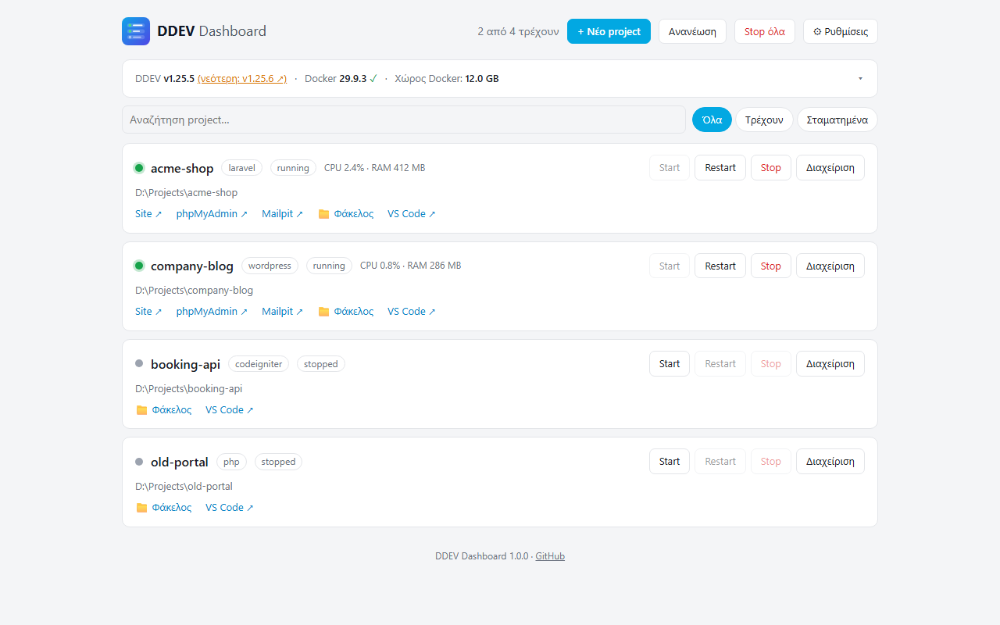
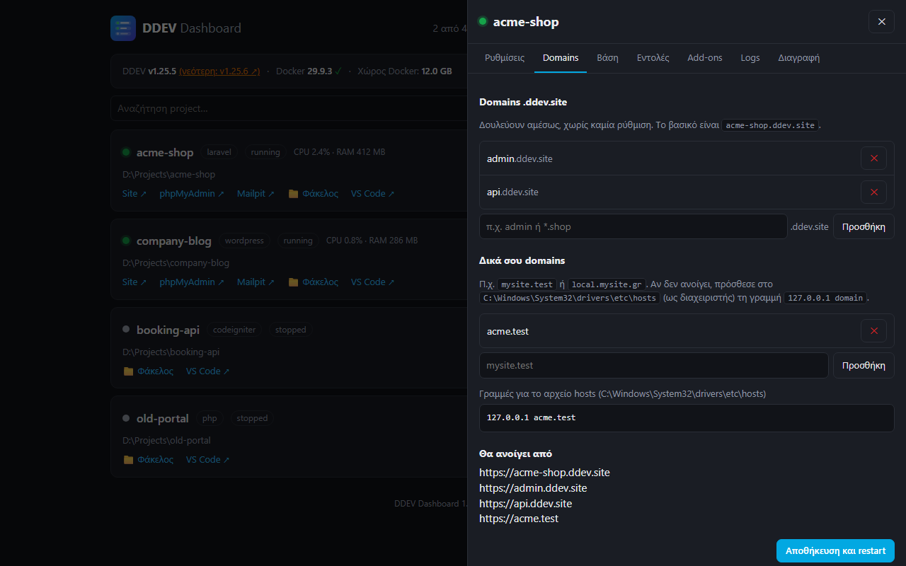
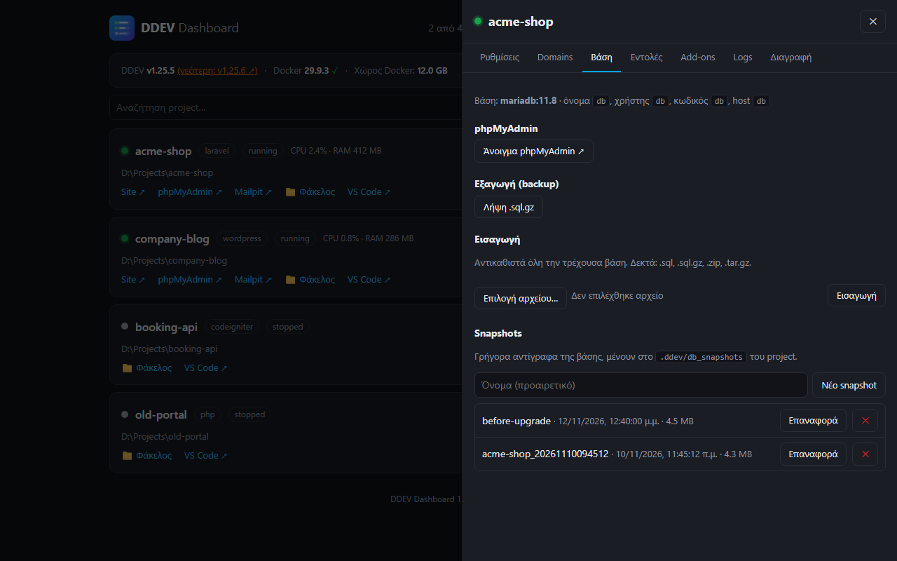
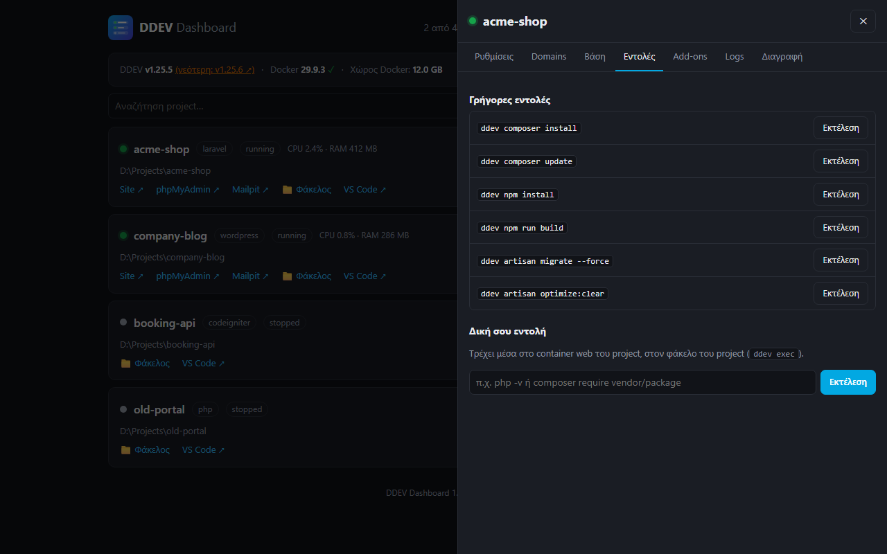
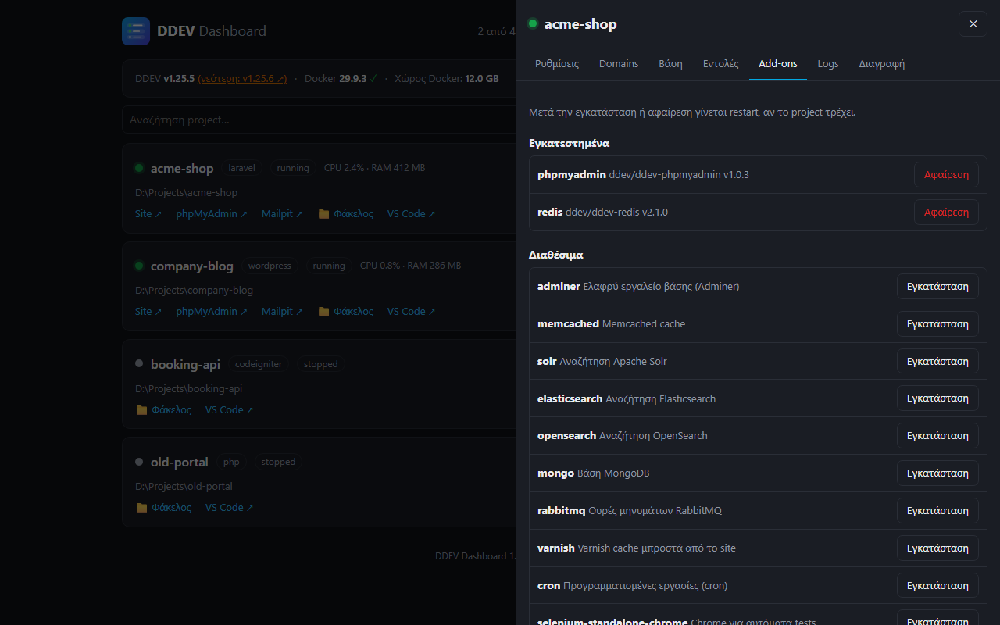

<p align="center">
  <picture>
    <source media="(prefers-color-scheme: dark)" srcset="assets/logo-dark.svg">
    
  </picture>
</p>

<p align="center">
  Τοπικό web περιβάλλον για τα projects του <a href="https://ddev.com">DDEV</a>: βλέπεις τι τρέχει, κάνεις start/stop,<br>
  φτιάχνεις projects, διαχειρίζεσαι domains, βάσεις, add-ons και logs, χωρίς εντολές.
</p>

<p align="center">
  <a href="https://github.com/npsaltakis/ddev-dashboard/actions/workflows/ci.yml"></a>
  <a href="https://github.com/npsaltakis/ddev-dashboard/releases"></a>
  <a href="LICENSE"></a>
</p>

<p align="center">
  <a href="README.md">English</a> · <b>Ελληνικά</b>
</p>

<p align="center">
  <picture>
    <source media="(prefers-color-scheme: dark)" srcset="docs/el/dashboard-dark.png">
    
  </picture>
</p>

## Δυνατότητες

- **Όλα τα projects με μια ματιά**: κατάσταση, CPU και RAM ανά project, αναζήτηση και φίλτρο, ζωντανή έξοδος όσο τρέχουν οι εντολές.
- **Start / Stop / Restart** ανά project και **Stop όλα** (`ddev poweroff`).
- **Νέο project**: σε άδειο φάκελο ή με **clone από git**. Διαλέγεις τύπο, PHP, web server, βάση, επιπλέον domains και προαιρετικά phpMyAdmin.
- **Installer CMS**: **WordPress, Joomla, Drupal** έτοιμα με χρήστη admin, ή **Laravel / CodeIgniter 4** με ρυθμισμένη βάση, με ένα κλικ (δες παρακάτω).
- **Domains**: προσθήκη και αφαίρεση `*.ddev.site` και δικών σου domains (π.χ. `mysite.test`), με έτοιμη τη γραμμή για το αρχείο hosts.
- **Ρυθμίσεις project**: τύπος, έκδοση PHP, web server, docroot, Xdebug on/off.
- **Βάση**: phpMyAdmin, λήψη backup `.sql.gz`, εισαγωγή dump, snapshots (δημιουργία, επαναφορά, διαγραφή).
- **Εντολές**: `composer`, `npm`, `artisan`, `spark`, `wp`, `drush` με ένα κλικ (ανάλογα με τον τύπο του project), ή οποιαδήποτε εντολή μέσα στο container web.
- **Add-ons**: Redis, Adminer, Solr, Elasticsearch κ.ά. με ένα κλικ, ή οποιοδήποτε `owner/repo`. Αφαιρούνται εξίσου εύκολα.
- **Κατάσταση συστήματος**: έκδοση DDEV (και αν βγήκε νεότερη), κατάσταση Docker και χώρος που πιάνει.
- **Άνοιγμα φακέλου** του project στον Explorer/Finder ή **στο VS Code**.
- **Ειδοποιήσεις** όταν τελειώνει μια εργασία, ενώ είσαι σε άλλο παράθυρο. Με κλικ ανοίγει το project.
- **Εγκατάσταση ως εφαρμογή**: δικό της παράθυρο και εικονίδιο στο taskbar με το πλήθος των projects που τρέχουν (δες παρακάτω).
- **Logs** των containers web και db.
- **Διαγραφή** project (τα αρχεία μένουν, προαιρετικό snapshot ασφαλείας).
- **Ελληνικά και English**, ανοιχτό και σκούρο θέμα.
- Δουλεύει όπου τρέχει το DDEV: **WSL, Linux, macOS, Windows**.

| Domains | Βάση |
|---|---|
|  |  |
| **Εντολές** | **Add-ons** |
|  |  |

## Τι χρειάζεται

- [DDEV](https://ddev.readthedocs.io/en/stable/users/install/) εγκατεστημένο και λειτουργικό (να δουλεύει το `ddev list`).
- Python 3.8 ή νεότερη. Καμία επιπλέον βιβλιοθήκη.
- `git`, μόνο αν φτιάχνεις projects από git repository.

Το dashboard τρέχει **στο ίδιο σύστημα με το DDEV**: μέσα στο WSL αν το DDEV είναι στο WSL, στα Windows αν το DDEV είναι εγκατεστημένο στα Windows κ.ο.κ.

## Εγκατάσταση

```bash
git clone https://github.com/npsaltakis/ddev-dashboard.git ~/ddev-dashboard
python3 ~/ddev-dashboard/server.py
```

Σε Windows (DDEV για Windows):

```powershell
git clone https://github.com/npsaltakis/ddev-dashboard.git C:\ddev-dashboard
python C:\ddev-dashboard\server.py
```

Άνοιξε το **http://localhost:8099**. Για άλλο port όρισε το `DDEV_DASHBOARD_PORT`.

Για ενημέρωση: `git pull` στον φάκελο και επανεκκίνηση του dashboard.

### Νέο site με WordPress, Joomla κ.ά.

**+ Νέο project** → στο «Τι θα στηθεί» διάλεξε CMS, γράψε φάκελο (π.χ. `D:\Projects\mysite`), PHP, βάση και στοιχεία admin, και πάτα **Δημιουργία**. Το dashboard κάνει μόνο του όλα τα βήματα, με ζωντανό log:

| | Βήματα |
|---|---|
| WordPress | `ddev config --project-type=wordpress`, `ddev start`, `ddev wp core download`, `ddev wp core install` |
| Joomla | `ddev config --project-type=joomla`, `ddev start`, λήψη της τελευταίας έκδοσης από το downloads.joomla.org, `ddev php installation/joomla.php install` (βάση `db`, χρήστης/κωδικός `db`/`db`) |
| Drupal | `ddev config --project-type=drupal11 --docroot=web`, `ddev composer create-project drupal/recommended-project`, `drush site:install` |
| Laravel | `ddev composer create-project laravel/laravel`, `ddev artisan migrate` |
| CodeIgniter 4 | `ddev composer create-project codeigniter4/appstarter`, `.env` με τη βάση του DDEV |

Στο τέλος (αν είναι τσεκαρισμένο) μπαίνει phpMyAdmin (`ddev add-on get ddev/ddev-phpmyadmin` και `ddev restart`). Το site ανοίγει στο `https://<όνομα>.ddev.site`. Ο φάκελος πρέπει να μην υπάρχει ή να είναι άδειος. Ο κωδικός admin κρύβεται (`***`) στο log και δεν αποθηκεύεται πουθενά.

### Χρήση ως εφαρμογή

Άνοιξε το dashboard στον Edge ή στο Chrome και πάτα **⚙ Ρυθμίσεις → Εγκατάσταση** (ή από το μενού του browser **⋯ → Εφαρμογές → Εγκατάσταση αυτής της τοποθεσίας ως εφαρμογής**). Ανοίγει σε δικό του παράθυρο, με εικονίδιο στο taskbar και στο Start, και το εικονίδιο δείχνει πόσα projects τρέχουν.

Για **ειδοποιήσεις** όταν τελειώνει μια εργασία, τσέκαρε **⚙ Ρυθμίσεις → Ειδοποιήσεις** και επίτρεψέ τες όταν ρωτήσει ο browser.

### Δοκιμή χωρίς DDEV

Η λειτουργία demo δείχνει δοκιμαστικά projects, με όλες τις ενέργειες απενεργοποιημένες:

```bash
DDEV_DASHBOARD_DEMO=1 python3 server.py
```

## Αυτόματη εκκίνηση

Άνοιξε **⚙ Ρυθμίσεις → Αυτόματη εκκίνηση του dashboard**. Εκεί υπάρχουν έτοιμες εντολές για το σύστημά σου, με τις σωστές διαδρομές και κουμπί αντιγραφής:

| Σύστημα | Τρόπος |
|---|---|
| WSL / Linux | systemd user service `ddev-dashboard` + `loginctl enable-linger`. Στο WSL πρέπει να είναι ενεργό το systemd (`[boot] systemd=true` στο `/etc/wsl.conf`). |
| macOS | LaunchAgent `com.ddev.dashboard` |
| Windows | Scheduled Task «DDEV Dashboard» στη σύνδεση (με `pythonw`, χωρίς παράθυρο) |

Στο WSL, αν το mkcert είναι στα Windows (`CAROOT` στον φάκελο των Windows), δώσε το `CAROOT` και στο service, αλλιώς τα projects που ξεκινούν από το dashboard παίρνουν `http://` αντί για `https://`:

```bash
mkdir -p ~/.config/systemd/user/ddev-dashboard.service.d
printf '[Service]\nEnvironment=CAROOT=%s\n' "$(mkcert -CAROOT)" > ~/.config/systemd/user/ddev-dashboard.service.d/caroot.conf
systemctl --user daemon-reload && systemctl --user restart ddev-dashboard
```

Σε WSL / Linux:

```bash
systemctl --user restart ddev-dashboard          # επανεκκίνηση
systemctl --user disable --now ddev-dashboard    # απενεργοποίηση
journalctl --user -u ddev-dashboard -f           # logs του dashboard
```

## Ρυθμίσεις

Οι **⚙ Ρυθμίσεις** αποθηκεύονται στο `settings.json`, δίπλα στο `server.py`:

- **Γλώσσα**: Ελληνικά ή English.
- **Πού τρέχει το DDEV**: εντοπίζεται αυτόματα ή το ορίζεις εσύ. Από αυτό εξαρτάται πώς γράφεις τις διαδρομές (στο WSL γράφεις `D:\Projects\site` και γίνεται `/mnt/d/Projects/site`), ποιο αρχείο hosts προτείνεται, πώς ανοίγουν οι φάκελοι και ποιες εντολές αυτόματης εκκίνησης εμφανίζονται.
- **Προεπιλεγμένος φάκελος για νέα projects**: κενό σημαίνει ο φάκελος όπου βρίσκονται τα περισσότερα projects σου.

Links όπως `http://localhost:8099/#project=myshop&tab=db`, `#new` και `#settings` ανοίγουν απευθείας μια καρτέλα project ή ένα παράθυρο.

## Ασφάλεια

Το DDEV Dashboard είναι φτιαγμένο για το δικό σου μηχάνημα.

- Ακούει μόνο στο `127.0.0.1`, οπότε δεν φαίνεται στο δίκτυο.
- Απαντά μόνο σε αιτήματα προς `localhost` (προστασία από DNS rebinding).
- Οι ενέργειες θέλουν ειδικό header, οπότε άλλα sites δεν μπορούν να τις ενεργοποιήσουν από τον browser σου.
- Τα στοιχεία των φορμών (ονόματα, domains, εκδόσεις, docroot, add-ons, git URLs) ελέγχονται, και το ddev τρέχει χωρίς shell. Οι δικές σου εντολές τρέχουν μέσα στο container web του project, όχι στον υπολογιστή σου.

## Ανάπτυξη

```
server.py      HTTP server και κλήσεις στο ddev (μόνο τυπική βιβλιοθήκη Python)
index.html     όλο το περιβάλλον (χωρίς build)
assets/        λογότυπο, εικονίδιο, social preview
docs/          screenshots
tests/         tests και δοκιμαστικά δεδομένα
```

```bash
python3 -m unittest discover -s tests -v
```

Τα screenshots βγαίνουν από τη λειτουργία demo. Issues και pull requests είναι ευπρόσδεκτα.

## Άδεια

[MIT](LICENSE)

Το DDEV Dashboard είναι ανεξάρτητο project, χωρίς σχέση ή έγκριση από το DDEV Foundation. Το όνομα «DDEV» χρησιμοποιείται μόνο για να περιγράψει με τι συνεργάζεται.
