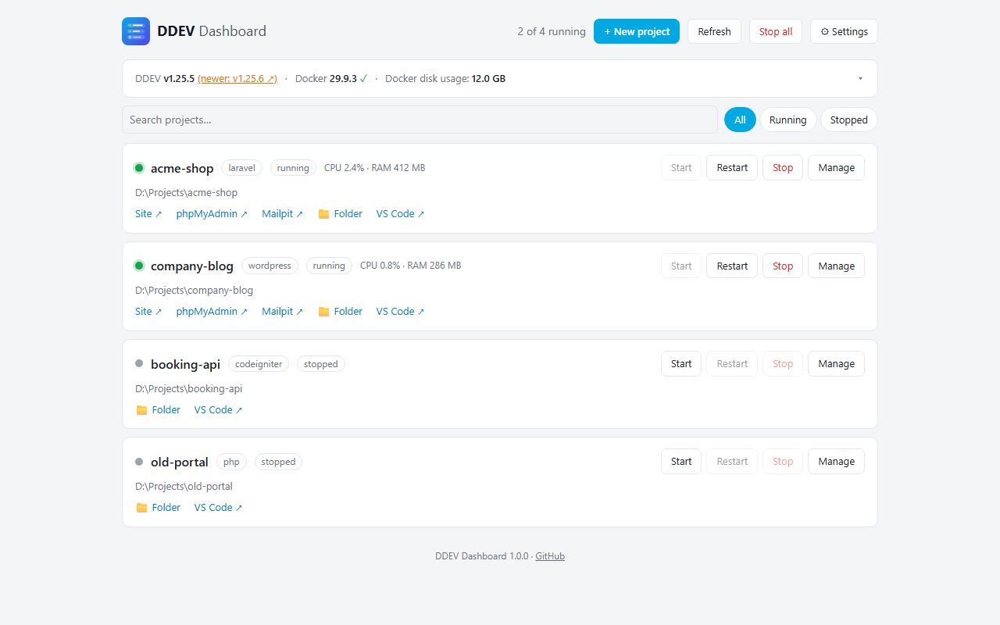
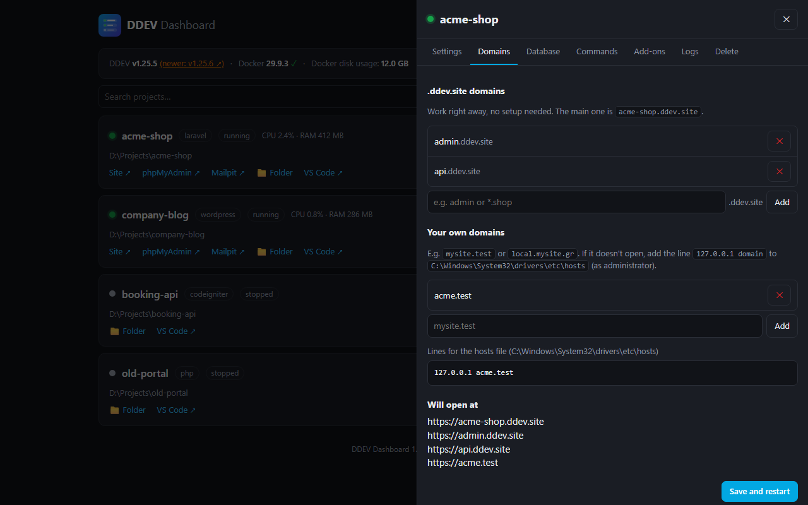
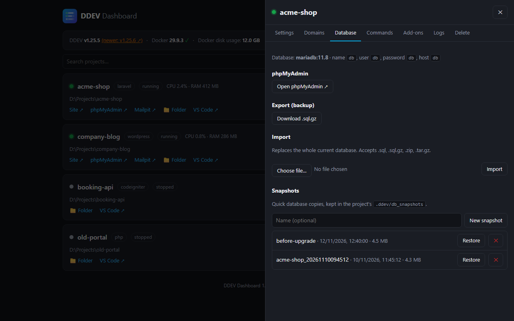
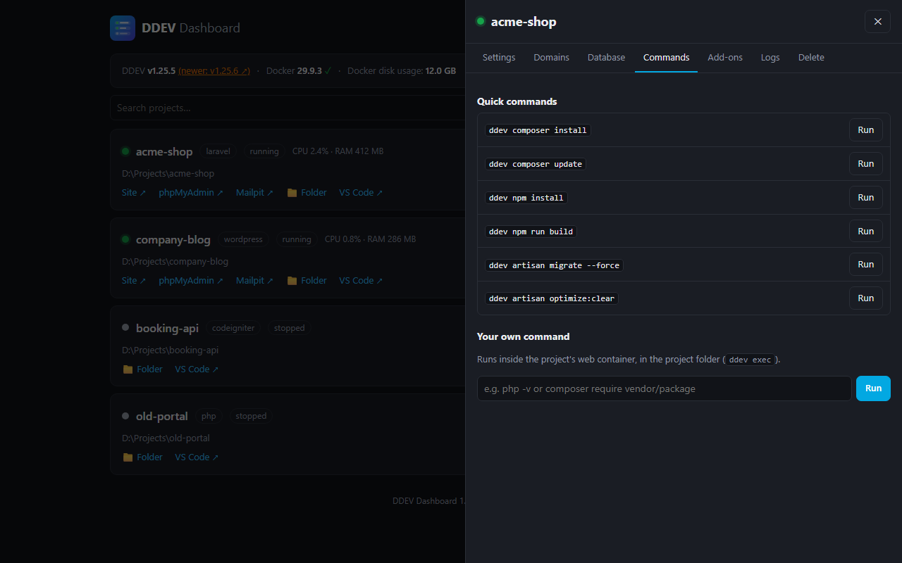
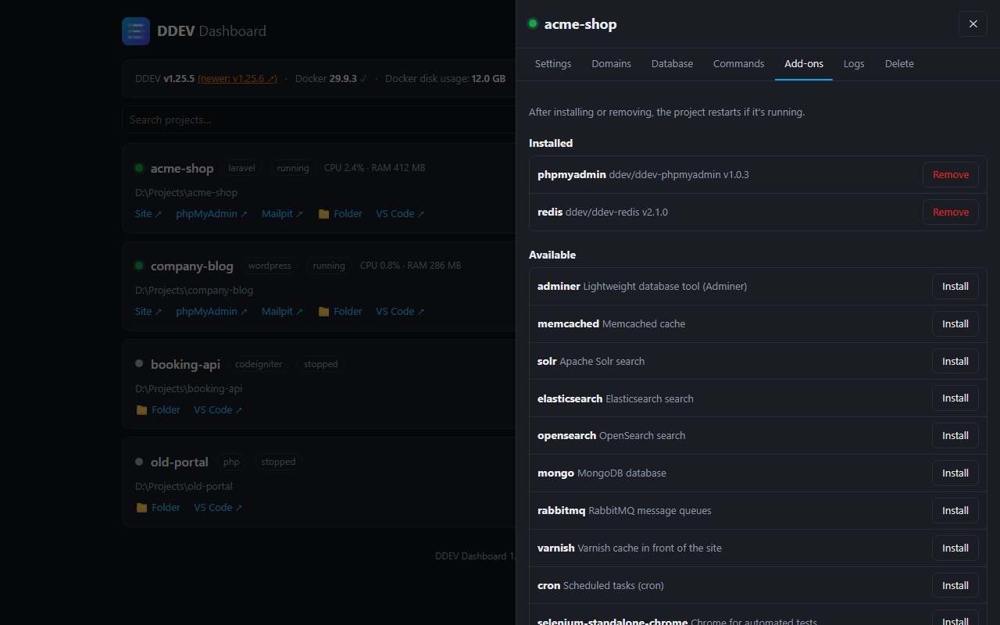

<p align="center">
  <picture>
    <source media="(prefers-color-scheme: dark)" srcset="assets/logo-dark.svg">
    
  </picture>
</p>

<p align="center">
  A local web UI for your <a href="https://ddev.com">DDEV</a> projects: see what's running, start and stop,<br>
  create projects, manage domains, databases, add-ons and logs, without typing commands.
</p>

<p align="center">
  <a href="https://github.com/npsaltakis/ddev-dashboard/actions/workflows/ci.yml"></a>
  <a href="https://github.com/npsaltakis/ddev-dashboard/releases"></a>
  <a href="LICENSE"></a>
</p>

<p align="center">
  <b>English</b> · <a href="README.el.md">Ελληνικά</a>
</p>

<p align="center">
  <picture>
    <source media="(prefers-color-scheme: dark)" srcset="docs/en/dashboard-dark.png">
    
  </picture>
</p>

## Features

- **Projects at a glance**: status, CPU and RAM of every project, search and filter, live output while commands run.
- **Start / Stop / Restart** per project, and **Stop all** (`ddev poweroff`).
- **New project**: from an empty folder or **cloned from git**. Choose type, PHP, web server, database, extra domains and optionally phpMyAdmin.
- **Domains**: add or remove `*.ddev.site` hostnames and your own domains (e.g. `mysite.test`), with the hosts-file line ready to copy.
- **Project settings**: type, PHP version, web server, docroot, Xdebug on/off.
- **Database**: open phpMyAdmin, download a `.sql.gz` backup, import a dump, create, restore and delete snapshots.
- **Commands**: one-click `composer`, `npm`, `artisan`, `spark`, `wp`, `drush` (depending on the project type), or any command inside the web container.
- **Add-ons**: install Redis, Adminer, Solr, Elasticsearch and more with one click, or any `owner/repo`. Remove them just as easily.
- **System status**: DDEV version (and whether a newer one is out), Docker status and Docker disk usage.
- **Open the project folder** in Explorer/Finder, or **open it in VS Code**.
- **Logs** for the web and db containers.
- **Delete** a project (files stay, optional safety snapshot).
- **Greek and English** interface, light and dark theme.
- Works wherever DDEV runs: **WSL, Linux, macOS, Windows**.

| Domains | Database |
|---|---|
|  |  |
| **Commands** | **Add-ons** |
|  |  |

## Requirements

- [DDEV](https://ddev.readthedocs.io/en/stable/users/install/) installed and working (`ddev list` runs).
- Python 3.8 or newer. No extra packages.
- `git`, only if you create projects from a git repository.

Run the dashboard **on the same system as DDEV**: inside WSL if DDEV is in WSL, on Windows if DDEV is installed on Windows, and so on.

## Install

```bash
git clone https://github.com/npsaltakis/ddev-dashboard.git ~/ddev-dashboard
python3 ~/ddev-dashboard/server.py
```

On Windows (DDEV for Windows):

```powershell
git clone https://github.com/npsaltakis/ddev-dashboard.git C:\ddev-dashboard
python C:\ddev-dashboard\server.py
```

Then open **http://localhost:8099**. Set `DDEV_DASHBOARD_PORT` to use another port.

To update: `git pull` in that folder, then restart the dashboard.

### Try it without DDEV

Demo mode shows sample projects and disables all actions:

```bash
DDEV_DASHBOARD_DEMO=1 python3 server.py
```

## Start automatically

Open **⚙ Settings → Start the dashboard automatically**. You'll find ready-made commands for your system, with the correct paths and a copy button:

| System | How |
|---|---|
| WSL / Linux | systemd user service `ddev-dashboard` + `loginctl enable-linger`. On WSL, systemd must be enabled (`[boot] systemd=true` in `/etc/wsl.conf`). |
| macOS | LaunchAgent `com.ddev.dashboard` |
| Windows | Scheduled Task "DDEV Dashboard" at sign-in (runs with `pythonw`, no window) |

On WSL / Linux:

```bash
systemctl --user restart ddev-dashboard          # restart
systemctl --user disable --now ddev-dashboard    # turn off
journalctl --user -u ddev-dashboard -f           # dashboard logs
```

## Settings

**⚙ Settings** stores its choices in `settings.json` next to `server.py`:

- **Language**: Ελληνικά or English.
- **Where DDEV runs**: detected automatically, or set it by hand. It decides how paths are entered (on WSL you can type `D:\Projects\site` and it becomes `/mnt/d/Projects/site`), which hosts file is suggested, how folders open and which autostart commands are shown.
- **Default folder for new projects**: empty means the folder that holds most of your projects.

Links like `http://localhost:8099/#project=myshop&tab=db`, `#new` and `#settings` open a project tab or dialog directly.

## Security

DDEV Dashboard is meant for your own machine.

- It listens on `127.0.0.1` only, so it is not reachable from the network.
- It answers only requests addressed to `localhost` (protects against DNS rebinding).
- Actions require a custom header, so other websites can't trigger them through your browser.
- Form input (names, domains, versions, docroot, add-on names, git URLs) is validated, and ddev runs without a shell. Custom commands run inside the project's web container, not on your machine.

## Development

```
server.py      HTTP server + ddev calls (Python standard library only)
index.html     the whole UI (no build step)
assets/        logo, icon, social preview
docs/          screenshots
tests/         unit tests and demo data
```

```bash
python3 -m unittest discover -s tests -v
```

Screenshots are taken from demo mode. Issues and pull requests are welcome.

## License

[MIT](LICENSE)

DDEV Dashboard is an independent project. It is not affiliated with or endorsed by the DDEV Foundation. "DDEV" is used only to describe what this tool works with.
